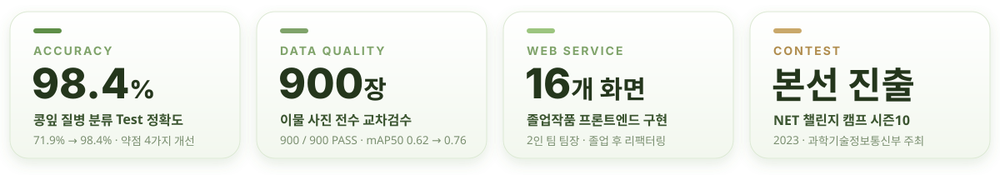
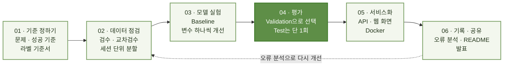

<!-- GitHub Profile README | hxxdxm/hxxdxm -->

 

 

## 🌱 About Me

> **모델의 점수에서 멈추지 않고, 그 점수를 믿을 수 있는 데이터 기준부터 사람이 쓰는 서비스 화면까지 연결합니다.**

<table>
<tr>
<td width="33%" valign="top">

**🔍 Vision AI & Data Quality**

라벨 기준서 작성 → 교차검수 → 데이터 분할 → 모델 학습 · 오류 분석까지, ‘**정답지가 맞는가**’부터 확인합니다.

</td>
<td width="33%" valign="top">

**⚙️ Model to Service**

Fine-tuning한 모델을 **FastAPI · Celery · Docker**로 서비스하고, **Next.js** 웹 화면으로 사용자에게 연결합니다.

</td>
<td width="33%" valign="top">

**📝 Evidence & Sharing**

실험 기록, 오류 분석표, README, 발표자료로 **다른 사람이 이해하고 검증할 수 있는 결과**를 남깁니다.

</td>
</tr>
</table>

 

## 📊 Impact at a Glance

※ 각 수치는 아래 프로젝트 README에 기록된 결과입니다. 조각김치 프로젝트의 수치는 5인 팀 공동 성과입니다.

 

## 🚀 Projects

### `01` 🌱 Plant Disease Vision API

**콩잎 사진 한 장으로 잎의 질병을 분류하는 AI 웹 서비스** &nbsp; 

<table>
<tr><td width="96" nowrap><b>문제</b></td><td>제공된 기준 코드로 학습하면 Test 정확도가 71.9%에 그치고, <b>병든 잎 13장을 정상으로 놓쳤습니다.</b> 모델을 실제 요청으로 받을 서비스 구조도 필요했습니다.</td></tr>
<tr><td width="96" nowrap><b>수행</b></td><td><code>ResNet-18</code>을 <b>각진잎반점병 · 녹병 · 정상</b> 3클래스로 Fine-tuning · 제공 코드의 약점 4가지를 <b>변수 하나씩 바꾸는 실험</b>으로 확인 · Validation으로 모델을 고른 뒤 Test는 단 1회 평가</td></tr>
<tr><td width="96" nowrap><b>결과</b></td><td>Test 정확도 <b>71.9% → 98.4%</b> · 병든 잎 놓침 <b>13장 → 0장</b> · 이미지 변형 8종 평균 정확도 95.7%</td></tr>
<tr><td width="96" nowrap><b>서비스</b></td><td>FastAPI 동기 API · Redis 캐시 · Celery 비동기 작업 · PostgreSQL 기록을 <b>Docker Compose 4개 서비스</b>로 구성</td></tr>
<tr><td width="96" nowrap><b>기술</b></td><td><code>PyTorch</code> <code>Transformers</code> <code>FastAPI</code> <code>Celery</code> <code>Redis</code> <code>PostgreSQL</code> <code>Docker</code></td></tr>
</table>

### `02` 🥬 조각김치 이물 검출 · 5인 팀

**라벨 검수 도구 제작부터 YOLO 검출 모델 학습 · 검증까지 한 사이클 완성** &nbsp; 

<table>
<tr><td width="96" nowrap><b>문제</b></td><td>식품 공장 이물 사진 900장 중 <b>52%의 라벨이 수정이 필요할 만큼 기준이 흔들려</b> 있었고, 같은 촬영 세션의 사진이 학습 · 검증 데이터에 섞여 있었습니다.</td></tr>
<tr><td width="96" nowrap><b>내 역할</b></td><td>LLM을 활용해 <b>라벨링 프로그램 1.0 초안</b> 작성 → 팀과 v4.1까지 발전 <b>Class · BBox 라벨 기준서</b> 작성, 250장 1차 검수 (애매한 경우 REVIEW로 보내 교차검수) 세션 단위 <b>데이터 재분할</b> · 산출물 11개 최종 점검</td></tr>
<tr><td width="96" nowrap><b>오류 분석</b></td><td>'나뭇가지' 예측 38건 중 20건을 직접 확인 → <b>16건이 김치 줄기 · 배추 그림자 착각</b>임을 오류 분석표로 정리</td></tr>
<tr><td width="96" nowrap><b>결과 (팀)</b></td><td>900 / 900 교차검수 PASS · Val mAP50 <b>0.62 → 0.76</b> · AI 후보 라벨 72% 그대로 승인</td></tr>
<tr><td width="96" nowrap><b>기술</b></td><td><code>Python</code> <code>tkinter</code> <code>YOLO11n</code> <code>Ultralytics</code> <code>Figma</code></td></tr>
</table>

### `03` 📚 이음 - 독서 커뮤니티 · 졸업작품 · 팀장

**독서 MBTI로 취향을 찾고, 같은 책을 읽는 사람과 모임 · 채팅으로 이어지는 서비스** &nbsp; 

<table>
<tr><td width="96" nowrap><b>문제</b></td><td>혼자 하는 독서를 <b>취향이 맞는 사람과 연결</b>하고, 감상과 문장을 나눌 공간이 필요했습니다.</td></tr>
<tr><td width="96" nowrap><b>내 역할</b></td><td>2인 팀 <b>팀장</b> · 서비스 기획 · UI/UX 설계 · <b>프론트엔드 16개 화면</b> 구현 (모임방 채팅, DM, 필사 전시회, 마이페이지 등)</td></tr>
<tr><td width="96" nowrap><b>개선</b></td><td>졸업 후 저장소를 다시 실행해 <b>빌드 오류(누락된 의존성)와 화면 버그</b>를 찾아 수정, 4개 화면에 흩어진 로직을 공통 함수로 정리</td></tr>
<tr><td width="96" nowrap><b>기술</b></td><td><code>Next.js</code> <code>React</code> <code>TypeScript</code> <code>Socket.io</code></td></tr>
</table>

<b>🗂️ 그 밖의 활동 펼치기 · CrossSafe · TrueHue</b>

 

| 프로젝트 | 내용 | 역할 · 상태 |
| :--- | :--- | :--- |
| **CrossSafe** | 교차로에서 우회전 차량의 일시정지 여부를 인식하는 시스템 · NET 챌린지 캠프 시즌10 | 자료조사 · 발표자료 제작 · **본선 진출** |
| **TrueHue** | 색각이상자를 위한 색 탐지 프로그램 (2인 팀) | Figma 화면 설계 · **진행 중** |

 

## 🎯 What I Do

| 영역 | 해 본 것 |
| :--- | :--- |
| **🔍 Vision AI** | 이미지 분류 Fine-tuning (ResNet-18), 객체 검출 (YOLO11n), 실패 사례 · 오검출 원인 분석 |
| **🧹 Data Quality** | Class · BBox 라벨 기준서, 1차 검수 · 교차검수 규칙, 촬영 세션 단위 데이터 분할 |
| **⚙️ Model Serving** | FastAPI · Redis 캐시 · Celery 비동기 작업 · PostgreSQL 기록 · Docker Compose |
| **🖥️ Web Frontend** | Next.js · React 화면 구현, 실시간 채팅 UI, Figma 화면 설계 |
| **📈 Data Analysis** | R · SPSS · Excel 통계 분석 (신뢰구간 · 가설검정 · 다변량분석) |
| **📝 Documentation** | README · 트러블슈팅 · 오류 분석표 · 발표자료 · 팀 산출물 점검 |

 

## 🔄 How I Work

점수가 올랐다는 사실보다 **왜 올랐는지 설명할 수 있는 것**을 더 중요하게 생각합니다.

 

## 🛠 Tech Stack

<b>전체 기술 스택 펼치기 · Language / AI / Backend / Web / Data</b>

 

| 분야 | 기술 |
| :--- | :--- |
| **Language** | Python, C, C++, JavaScript, TypeScript, R |
| **AI / Vision** | PyTorch, Hugging Face Transformers, YOLO11 (Ultralytics), OpenCV |
| **Backend / Infra** | FastAPI, Celery, Redis, PostgreSQL, Docker, Docker Compose, Nginx, Kubernetes, Linux |
| **Web / Frontend** | HTML5, CSS3, Next.js, React, Socket.io |
| **Data** | R, SPSS, Excel |
| **Collaboration** | Git, GitHub, Figma |

 

## 🎓 Education & Activities

| 기간 | 내용 | |
| :--- | :--- | :---: |
| 2023 – | **컴퓨터공학** 전공 | 🎓 |
| 2023.06 – 2023.11 | **K-디지털 챌린지 : NET 챌린지 캠프 시즌10** (과학기술정보통신부 주최) · CrossSafe | 🏆 본선 진출 |
| 2024 – | **빅데이터분석 융합전공** (부전공 18학점) | 📈 |
| 2026.06 | 춘계 졸업작품발표회 · 이음 (팀장 · 프론트엔드) | 🎤 발표 |
| 2026.07 – 2027.02 | 현장 데이터 기반 Vision AI & 산업분야 Vertical AI 융합 전문가 양성 과정 | 🌱 수강 중 |

<b>빅데이터분석 융합전공 수강 과목 보기</b>

 

| 과목 | 도구 · 내용 |
| :--- | :--- |
| 빅데이터마이닝 | `Excel` 신뢰구간 · 필요한 표본 크기 · 가설검정 |
| 빅데이터프로그래밍 | `R` |
| 다변량분석 | `SPSS` |
| 빅데이터마케팅 · 빅데이터시각화디자인 · 빅데이터개론 | 데이터 해석 · 시각화 |

 

## 📬 Contact

 

Set the standard · Check the data · Build the model · Serve the result · Share the evidence

