<div align="center">

# 📚 이음

**독서의 여운을 타인과 잇다**

독서 MBTI로 내 취향을 찾고, 같은 책을 읽는 사람들과 실시간으로 이야기하고,
다 읽은 책은 다른 사람에게 물려주는 선순환 독서 플랫폼

2026학년도 춘계 졸업작품 · TEAM 교환독서 · 2026.03 ~ 2026.06


</div>

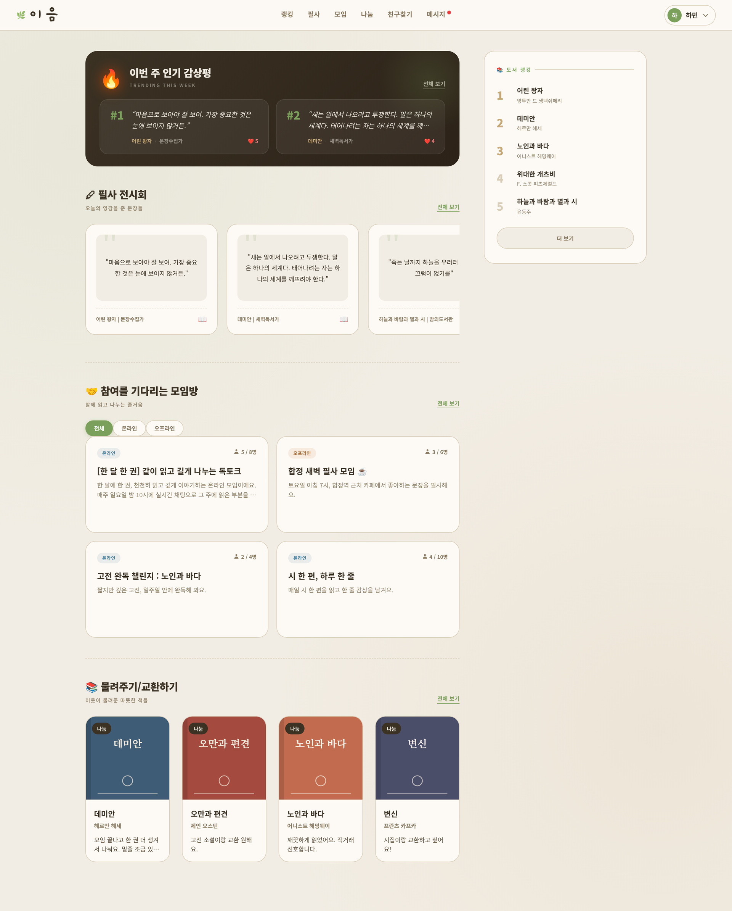

<details>
<summary>📌 졸업작품 발표회 포스터 보기</summary>
<br>
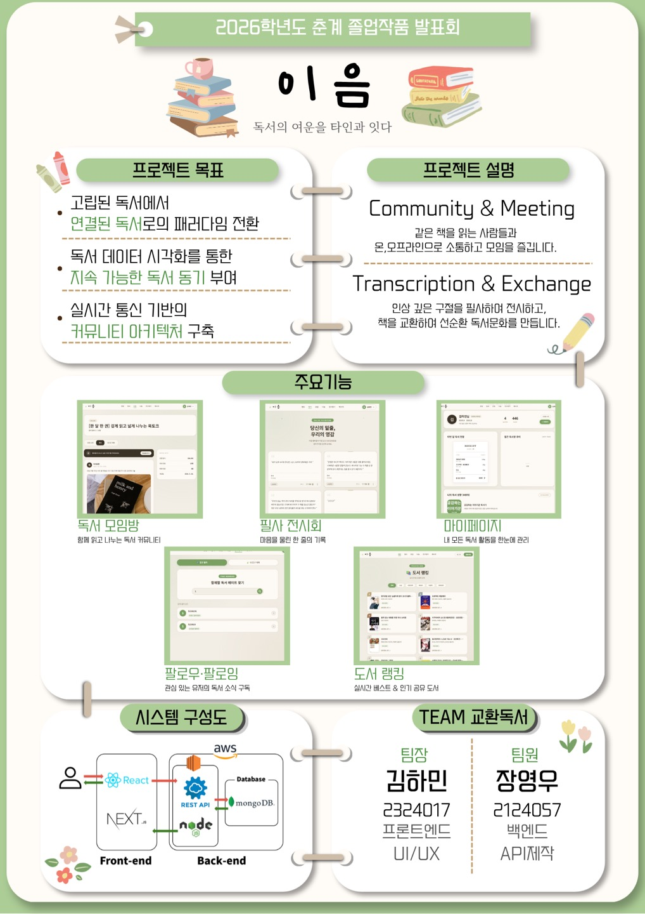
</details>

<br>

## 🙋 내 역할

> **팀장 · 프론트엔드 · UI/UX 디자인** (2인 팀 프로젝트: 프론트엔드 1명 / 백엔드 1명)

- 팀장으로서 서비스 기획과 일정 관리, 화면 설계(UI/UX)를 맡음
- Next.js App Router 기반 **16개 페이지, 약 7,000줄** 단독 설계·구현 (커밋 140개)
- **Socket.io 클라이언트**로 모임방 그룹 채팅과 1:1 DM 실시간 UI 구현
- **JWT 토큰 기반 인증 흐름** 구현: 로그인 유지(localStorage) / 세션 로그인(sessionStorage) 분기, 요청 헤더에 Bearer 토큰 첨부
- 회원가입·이메일 OTP 인증·비밀번호 재설정 등 인증 관련 화면 전체 구현
- 백엔드 REST API 연동 및 화면 단위 에러·로딩 처리

| 구분 | 담당 | 저장소 |
|---|---|---|
| 팀장 · Frontend · UI/UX | **김하민 (본인)** | 현재 저장소 |
| Backend · API | 장영우 [@523810](https://github.com/523810) | [hxxdxm/Capstone2-backend](https://github.com/hxxdxm/Capstone2-backend) (원본: [523810/Capston2](https://github.com/523810/Capston2)) |

<br>

## ✨ 주요 기능

| 기능 | 설명 | 페이지 |
|---|---|---|
| 🧠 **독서 MBTI** | 테스트 결과로 독서 성향을 분석하고 장르별 맞춤 도서 추천 | `/mypage` |
| 💬 **모임방 & 실시간 채팅** | 온·오프라인 모임방 생성, 초대 링크로 입장, Socket.io 그룹 채팅 | `/rooms`, `/rooms/[id]` |
| ✉️ **1:1 DM** | 다른 사용자 프로필에서 바로 실시간 개인 메시지 | `/dms`, `/dms/[userId]` |
| 👥 **팔로우·팔로잉** | 관심 있는 사용자를 팔로우해 독서 소식 구독 | `/profile/[id]`, `/search` |
| 🌡️ **독서 기록 & 독서 온도** | 읽은 페이지·완독 수를 기록하면 36.5°C에서 시작하는 '독서 온도'가 올라가는 게이미피케이션 | `/record` |
| ✍️ **필사 전시회** | 감명 깊은 문장을 사진과 함께 피드로 공유, 좋아요(스크랩) | `/annotations` |
| 🎁 **책 물려주기** | 다 읽은 책을 '나눔' 또는 '교환'으로 등록하는 게시판 | `/handmedowns` |
| 🔍 **도서 검색 & 랭킹** | 카카오 도서 검색 API, 알라딘 장르별 베스트셀러 랭킹 | `/search`, `/ranking` |
| 🔐 **회원 인증** | 회원가입, 이메일 OTP 인증, 이메일 찾기, 비밀번호 재설정 | `/signup`, `/login` 외 |

### 📸 화면 미리보기

> 배포 서버가 종료되어, 실제 프론트엔드 코드를 로컬에서 실행하고 **예시 데이터**를 넣어 촬영한 화면입니다.

| 독서 모임방 | 모임방 실시간 채팅 |
|:---:|:---:|
| 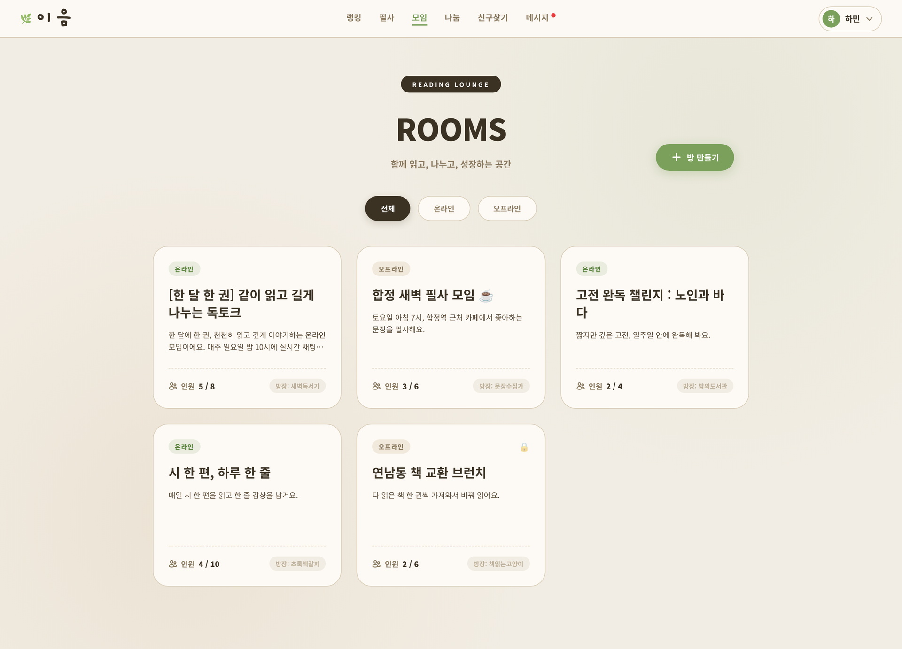 | 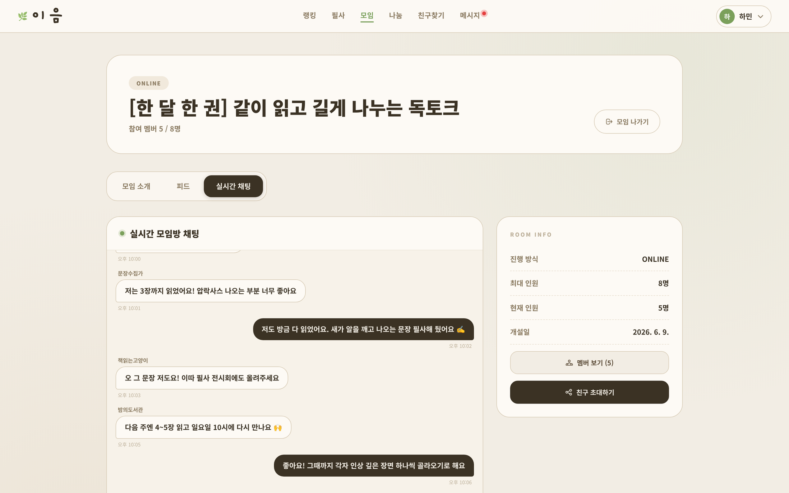 |
| **모임방 피드** | **필사 전시회** |
| 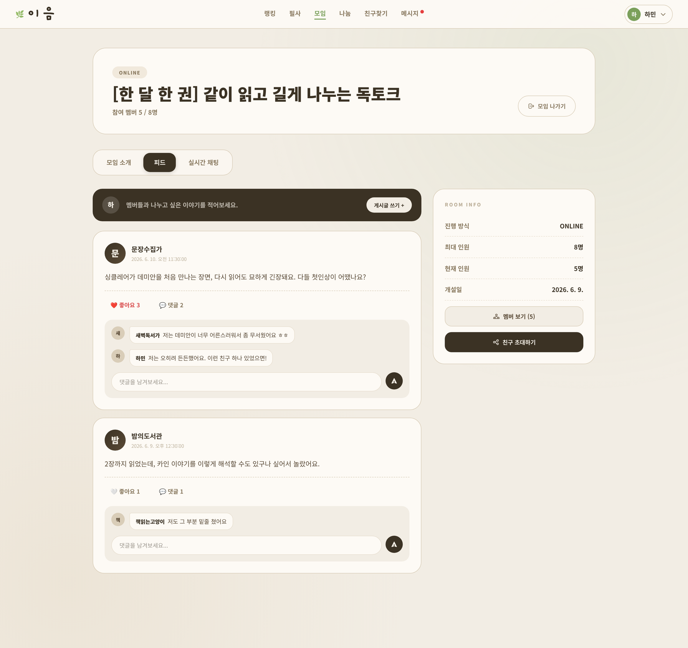 | 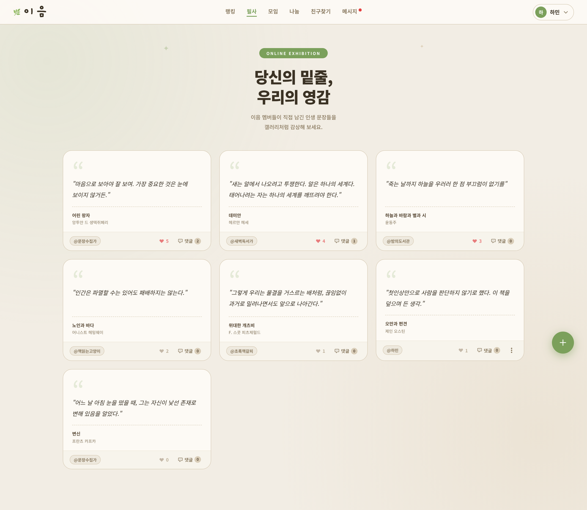 |
| **팔로우 · 프로필** | **도서 랭킹** |
| 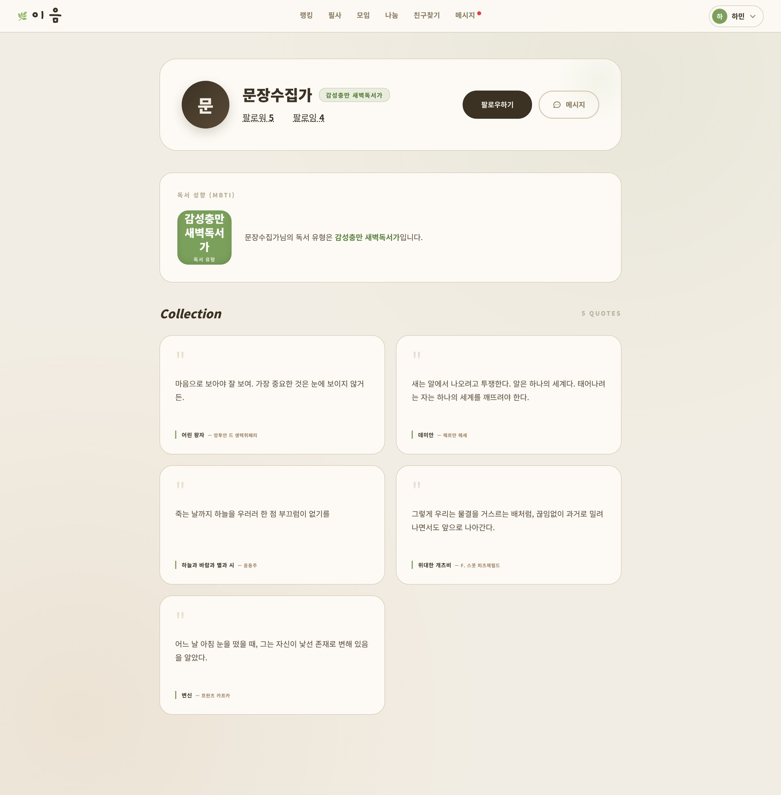 | 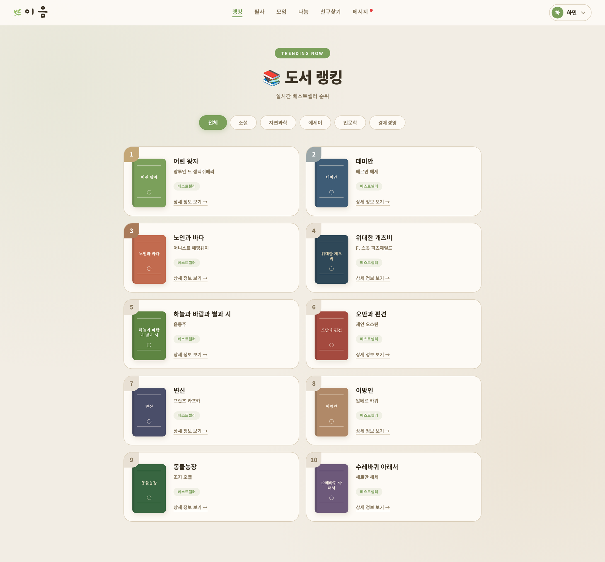 |
| **책 물려주기** | **마이페이지 (독서 영수증 · 월간 그래프 · MBTI)** |
| 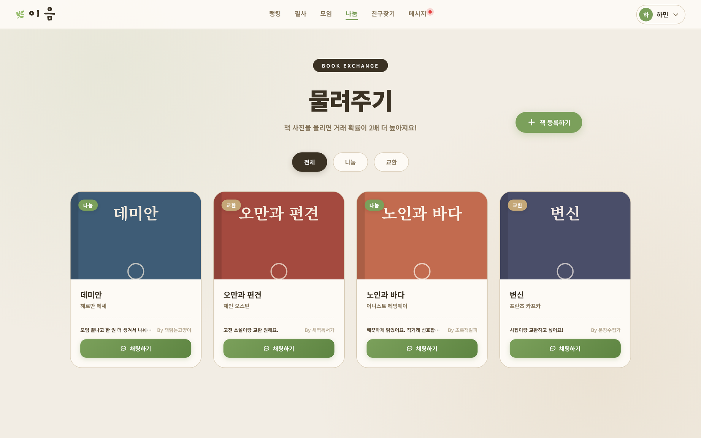 | 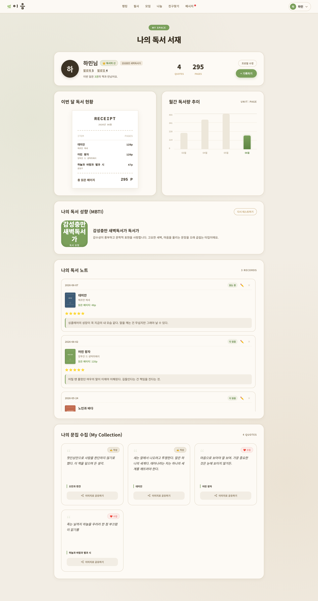 |

<br>

## 🏗️ 시스템 구성도

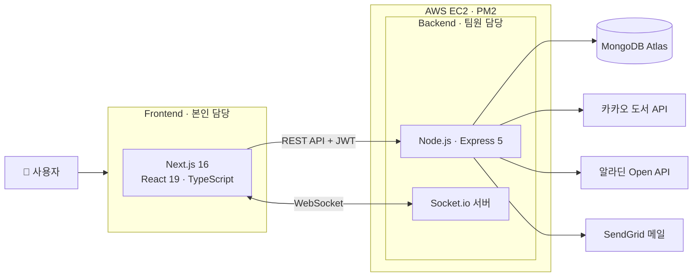

<br>

## 🛠️ 기술 스택

| 분야 | 기술 |
|---|---|
| Framework | Next.js 16 (App Router), React 19 |
| Language | TypeScript |
| Styling | Tailwind CSS 4, 페이지별 CSS |
| 실시간 통신 | socket.io-client |
| 인증 | JWT (Bearer Token) |
| 협업 | Git, GitHub |

<br>

## 📁 폴더 구조

```
re-ad/                      # 프론트엔드 프로젝트 폴더
├── app/                    # Next.js App Router (폴더 = URL 경로)
│   ├── page.tsx            # 메인
│   ├── login/ signup/      # 로그인, 회원가입
│   ├── find-email/ reset-password/
│   ├── rooms/              # 모임방 목록
│   │   └── [id]/           # 모임방 상세 + 실시간 채팅
│   ├── dms/                # DM 목록
│   │   └── [userId]/       # 1:1 실시간 DM
│   ├── record/             # 독서 기록, 독서 온도
│   ├── annotations/        # 필사 전시
│   ├── handmedowns/        # 책 물려주기 (+ [id] 상세)
│   ├── search/ ranking/    # 도서 검색, 베스트셀러 랭킹
│   ├── mypage/             # 마이페이지, 독서 MBTI
│   └── profile/[id]/       # 다른 사용자 프로필
└── components/             # Header, Footer, UserWidget 공통 컴포넌트
```

<br>

## 🔥 트러블슈팅

<!-- TODO: 실제로 겪은 문제로 바꾸거나 다듬어 주세요. 아래는 코드에서 보이는 후보입니다. -->

### 1. DM 메시지가 두 번씩 표시되는 문제

- **문제**: DM 화면에 다시 들어오거나 화면이 다시 그려지면 같은 메시지가 중복으로 표시됨
- **원인**: 컴포넌트가 다시 렌더링될 때마다 `socket.on('receiveDM')` 이벤트 리스너가 계속 추가로 등록됨
- **해결**:
  - 리스너 등록 전에 `socket.off('receiveDM')`로 기존 리스너 제거
  - `useRef`로 소켓 인스턴스를 하나만 유지하고, 이미 연결되어 있으면 새로 연결하지 않음
  - 페이지를 떠날 때 `useEffect` cleanup에서 `disconnect()` 호출
- **배운 점**: React 렌더링 주기와 소켓 연결 수명은 따로 관리해야 한다

### 2. (TODO) 두 번째 경험

- **문제**:
- **원인**:
- **해결**:
- **배운 점**:

<br>

## 🚀 실행 방법

```bash
cd re-ad
npm install
npm run dev     # http://localhost:3000
```

> 백엔드 서버 실행 방법은 [백엔드 저장소](https://github.com/hxxdxm/Capstone2-backend)를 참고하세요.

<br>

## 💭 회고

**👍 잘한 점**
- 기획 단계에서 정한 핵심 기능(모임방·실시간 채팅·DM·필사 전시·물려주기·독서 기록·랭킹·인증)을
  빠짐없이 화면으로 구현했습니다.
- 백엔드 담당자와 API 응답 형태를 맞춰 가며 16개 페이지를 끝까지 연결했습니다.

**🤔 아쉬운 점**
- 서버 주소와 요청 로직이 클라이언트 코드에 그대로 노출되어 있습니다. 브라우저 개발자 도구만
  열어도 API 서버 주소를 확인할 수 있는 구조였습니다.
- 독서 MBTI, 독서 온도처럼 이음만의 차별화 기능이 있었지만 화면에서 충분히 부각하지 못했습니다.
  결과적으로 "게시판 + 실시간 채팅"처럼 보일 수 있는 구성이 되었습니다.

**🚀 개선하고 싶은 점**
- API 주소를 환경변수로 분리하고, Next.js Route Handler를 프록시로 두어 실제 서버 주소를
  클라이언트에서 숨기기
- 공통 fetch 함수를 만들어 인증 헤더 처리와 에러 처리를 한 곳으로 통합하기
- 독서 MBTI 결과를 모임방·도서 추천과 연결해, 취향이 맞는 사람과 책을 이어주는 서비스
  정체성을 강화하기